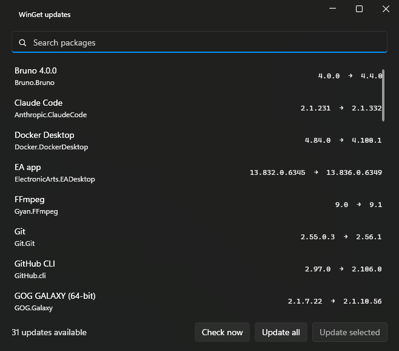

# WinGetTray

A small Windows 11 tray app for [winget](https://github.com/microsoft/winget-cli): it tells you when
updates are available, shows them in a list you can search, and installs them (one, several, or all).
The window is a real Fluent one — [WPF-UI](https://github.com/lepoco/wpfui) `FluentWindow` with a Mica
backdrop, so it matches Windows 11 instead of imitating it.



## Why

`winget upgrade` is a CLI, and Microsoft Store only updates Store apps. WinGetTray wraps the CLI in a
notification-area icon with a normal window: no background service, no package manager of its own,
no dependency on a Linux-side tooling stack.

## Behaviour

- Checks `winget upgrade` shortly after login and then every 12 hours (configurable).
- Amber arrow + a balloon notification when upgrades exist, green tick when everything is current.
- The window lists every pending upgrade with `current → available`, filtered by a search box
  (matches package name or id, case-insensitive).
- **Update selected** / **Update all** relaunch the app elevated, so machine-scope installers succeed;
  Windows shows the usual administrator prompt.
- Optional "Install updates automatically" runs the same install on any check that finds work.
- "Start with Windows" writes a per-user `Run` entry; nothing is installed as a service.

## Install

Download `WinGetTray.exe` from the [latest CI artifact](../../actions/workflows/ci.yml) or build it:

```powershell
git clone https://github.com/PaulBujor/winget-tray
cd winget-tray
dotnet publish src/WinGetTray/WinGetTray.csproj -c Release -o out
```

Run `out\WinGetTray.exe`. It needs the **.NET 10 Desktop Runtime** (framework-dependent single file,
about 7 MB — most of that is WPF-UI's embedded Fluent theme and icon set). To have it start
automatically, right-click the tray icon → **Start with Windows**.

## CLI

Useful for scripting and for verifying the app's own behaviour:

```powershell
WinGetTray.exe --check          # list pending upgrades, exit code 10 if any
WinGetTray.exe --check --json   # same, as JSON
WinGetTray.exe --update-all     # apply everything (run elevated for machine-scope packages)
WinGetTray.exe --update-ids "Git.Git,Microsoft.VisualStudioCode"
WinGetTray.exe --show           # open the window of a running instance
```

## Configuration

`%LOCALAPPDATA%\WinGetTray\settings.json`

| Key | Meaning |
| --- | --- |
| `IntervalHours` | Check interval, default `12` |
| `AutoInstall` | Install whenever a check finds updates, default `false` |
| `WingetPath` | Optional explicit path to `winget.exe` |

Log: `%LOCALAPPDATA%\WinGetTray\winget-tray.log` (rotated at 1 MB).

## Known limits

- winget has no machine-readable output for `upgrade`, so the list is parsed from its fixed-width
  table. Columns are located via the header row; the parsing is covered by tests against real output
  (see `tests/WinGetTray.Core.Tests/Fixtures`). A future winget JSON output would replace this.
- Elevation is all-or-nothing per run: user-scope packages don't need it, but the app always asks so
  that machine-scope installers don't fail silently.
- Windows-only, x64. No installer, no auto-update: Dependabot keeps dependencies fresh, you rebuild
  or re-download when you care.
- The only runtime dependency is WPF-UI (MIT, ~6 MB of embedded Fluent resources). That is what makes
  the window a genuine `FluentWindow`; dropping it would mean hand-rolled styling again.

## Layout

```
src/WinGetTray        Fluent window (WPF-UI) + tray icon (WinForms NotifyIcon only)
src/WinGetTray.Core   settings, logging, winget invocation, parsing, filtering (no UI)
tests/                xunit tests over the parser and filter, incl. a real winget output fixture
tools/make-icon.py    regenerates src/WinGetTray/app.ico
```

## Licence

MIT — see [LICENSE](LICENSE). Icon and code generated for this project; not affiliated with Microsoft.
